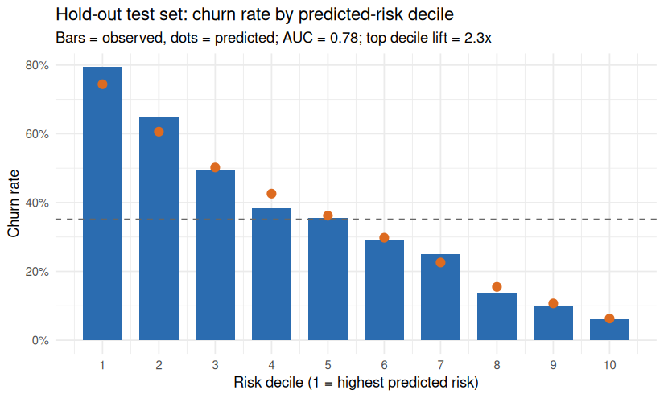
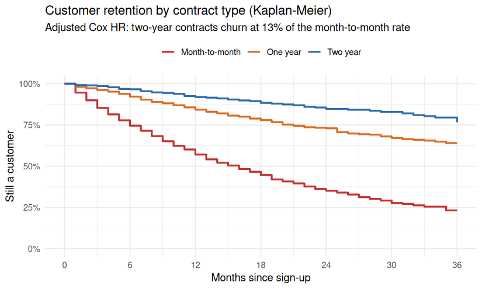

# Customer churn analysis: who leaves, when, and how much revenue is at risk (R)


[](https://github.com/alex-sukhoi/customer-churn-analysis/actions/workflows/reproduce.yml)

A churn analysis for a subscription business that answers the three questions a retention team
asks:

1. **Who** is likely to churn? (logistic regression, validated on a hold-out set)
2. **When** do customers leave? (Kaplan–Meier retention curves, Cox regression)
3. **Where** should the retention budget go? (risk segments and expected revenue at risk)

> **Data:** synthetic. 6,000 telecom-style customers observed for up to 36 months, generated in
> `R/01_simulate_data.R`.
> An interactive version of this kind of analysis is on my
> [Tableau Public profile (Churn Management dashboard)](https://public.tableau.com/app/profile/oleksii.sukhoi).

## Key findings

| | |
|---|---|
| Overall churn | 35.4% within the observation window |
| Strongest driver | Contract type: churn 50.6% month-to-month vs 11.5% on two-year contracts |
| Model quality (hold-out) | AUC 0.78; top risk decile churns 2.3× the average |
| Targeting | The top 30% riskiest customers include 55% of all churners |
| Revenue | High-risk segment = 77% of expected monthly revenue at risk |

## 1. Who churns: logistic regression

Odds ratios on the 70% training set (tenure is excluded because it partly *is* the outcome):

| Driver | Odds ratio (95% CI) |
|---|---|
| One-year vs month-to-month contract | 0.23 (0.19–0.28) |
| Two-year vs month-to-month contract | 0.13 (0.10–0.16) |
| Tech support subscribed | 0.50 (0.41–0.60) |
| Automatic payment | 0.60 (0.52–0.69) |
| Each support ticket (last 6 months) | 1.33 (1.23–1.43) |
| Each +1 in monthly charges | 1.026 (1.014–1.038) |

<p align="center"></p>

On the 30% hold-out set the model separates customers well (AUC 0.78, Brier 0.18), and predicted
risk matches observed churn in every decile, so the scores can be used directly as probabilities.

## 2. When they churn: retention curves

<p align="center"></p>

| Contract | Retained at 12 months | 24 months | 36 months |
|---|---|---|---|
| Month-to-month | 57.1% | 35.1% | 23.2% |
| One year | 84.3% | 73.0% | 64.0% |
| Two year | 91.9% | 84.7% | 76.7% |

The adjusted Cox model gives the same picture: two-year contracts have 13% of the month-to-month
hazard, and each support ticket raises the hazard by 25%.

## 3. Where to act: risk segments

| Risk segment | Customers | Actual churn | Share of revenue at risk |
|---|---|---|---|
| High (p > 0.35) | 2,886 | 54.3% | 77.3% |
| Medium (0.15–0.35) | 1,659 | 25.6% | 17.6% |
| Low (< 0.15) | 1,455 | 9.1% | 5.1% |

**Recommendations**
- Offer month-to-month customers in the high-risk segment an incentive to move to an annual contract.
- Bundle tech support for fibre customers. They raise the most tickets, and tickets predict churn.
- Promote auto-pay at onboarding.
- Re-score customers monthly and track uplift with a control group.

## Repository structure

```
R/01_simulate_data.R    synthetic customer base with time-to-churn
R/02_churn_analysis.R   segment profile, logistic model + validation, KM/Cox, risk segments
results/                churn by segment, odds ratios, decile lift, AUC, retention, HRs, risk segments
figures/                retention curves, lift chart
```

## How to run

```r
install.packages(c("survival", "ggplot2", "scales"))
source("run_all.R")
```

---
**Author:** [Oleksii Sukhoi](https://github.com/alex-sukhoi), statistician and data analyst · [LinkedIn](https://www.linkedin.com/in/oleksii-sukhoi-4b60161a7)
